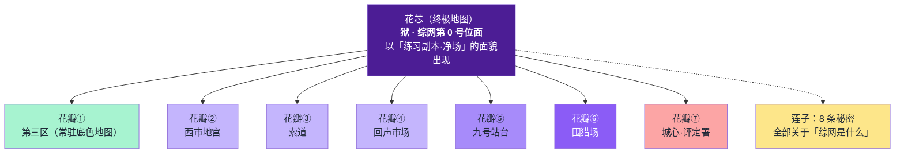

# 05 · 地图设定：莲花地图 ＋ 历史千层饼

> 本文件是本书**地图与地理的唯一真相来源**。与 `02_全局大纲` 冲突时以本文件为准。
> 方法依据：宅猪「莲花地图法」＋「千层饼地图法」，见 `04_方法论调研与应用`。

---

## 一、莲花结构总览

**运行规则（莲花法三条约束的本书执行版）**

1. **花芯永不写完**——「净场」在第 01 章就出现，但到第一卷结束都不会被走完。每次进入只揭开一层。
2. **每次离开花瓣，必须回花芯**——主角每完成一个副本，都要重进净场做一次实验（这也符合他的性格：先验证，再行动）。**同时揭开一条莲子。**
3. **花瓣的收益不是资源，是信息**——每个副本结束时，主角得到的核心收获必须是「关于花芯的一条新情报」，积分与道具只是附带。

---

## 二、花芯：狱（综网第 0 号位面）

| 项目 | 设定 |
|---|---|
| 官方名称 | 无。综网表里它的编号是 **000**，名字一栏是空的 |
| 民间称法 | 「练习副本·净场」（因为唯一能接入它人口的，就是那个最低阶的练习副本界面） |
| 本质 | **上一个被接入的文明留下的容器**（L4 层信息，第一卷末才隐约触及） |
| 呈现形态 | 一片没有边界的灰；硬质地面、灰白雾墙、无声 |
| 为什么看起来像练习场 | 因为综网把它**当成**练习场来用——一个被清空过一次的位面，正好适合当新手的靶场 |
| 关键异常 | ① 这里没有死亡判定（第 02 章原文交代）；② 这里的重置不消耗次数；③ 这里**会结算逆命值** |

### 净场内的可交互要素

| 要素 | 说明 | 首次出现 |
|---|---|---|
| **灰犬** | 综网官方标注强度最低的战斗单位（F 级）。无眼，靠热量感知，先攻固定 **12**，攻击间隔约 3.2 秒 | 02 |
| **雾墙** | 边界，向任何方向走 400 步会回到原点 | 02（未被主角发现，第 09 章才发现） |
| **地面刻痕** | 灰地板某处有极浅的凹痕，像一行被磨平的字 | 09（第一次发现） |
| **"祝你好运"** | 副本提示的第三行字；综网任何其他提示里都没有这四个字 | 01 |

> **F7 伏笔的设定解释**：灰犬从不补刀，不是因为它弱，是因为**它不是来杀人的**。它是这个容器里唯一还活着的东西，它的职能是「**测试**」。

---

## 二·补　宿（综网的私人空间）

> 补强来源：无限恐怖 TRPG 的「个人房间」机制（上限 27 立方千米，可自定义材质式样，除兑换物外不可带出）。详见 `16_无限流规则校验` 第四节。

| 项目 | 规则 |
|---|---|
| 名称 | **宿** |
| 位置 | 登录空间内侧，每人一间；是玩家在综网里唯一的私人坐标 |
| 配额规则 | 按属性总和分配：甲等 **27 立方千米**／乙等 **2.7 立方千米**／丙等 **0.27 立方千米** |
| 可自定义 | 材质、式样、布局、内部陈设 |
| 携带限制 | 除花费积分兑换的物品外，宿内的东西**带不出登录空间** |
| **陆沉的宿** | **0 立方米。** 面板只给一行提示：`【该账号空间配额为 0。】` |

**叙事功能**

1. 他连一个能放东西的地方都没有——全部家当揣在身上（这也是他总背着一个旧包的原因）。
2. 「配额为 0」与「该账号不适用常规评估」**同源**：系统从来没有为他准备过位置。
3. 第 19 章他升到 5 级、属性总和越过 30，配额跳到 **0.27 立方千米**——**他第一次拥有了一个只属于自己的房间**。
4. 卷末他用那个房间安置妹妹。这是全卷唯一一处「看得见的成长证据」。

---

## 三、莲子：8 条秘密清单

> 每揭开一条，主角就离「综网是什么」更近一步。本清单是全书的主线驱动力。

| # | 秘密 | 何时揭开 | 揭开方式 |
|---|---|---|---|
| N1 | 净场为什么没有边界？ | 第 09 章 | 他实测出雾墙 = 走 400 步回到原点 → 这不是场地，是**封闭容器** |
| N2 | 「祝你好运」是谁写的？ | 第 16 章 | 老周说：那句话不是系统写的，是**上一个人**留的 |
| N3 | 灰犬为什么不补刀？ | 第 11 章 | 他在被记录的状态下重伤，灰犬停手 → 它在**测量，不在猎杀** |
| N4 | 「该账号不适用常规评估」是谁判定的？ | 第 17 章 | 面板的判定主体不是综网，是一个名字被划掉的机构 |
| N5 | 逆命者是漏洞还是补偿机制？ | 第 16 章 | **被设计出来的**——系统的自我修正程序 |
| N6 | 职业是随机生成的，为什么能随机出隐藏分支？ | 第 17 章 | 因为那个随机数不是随机的 |
| N7 | 第 0 号位面为什么需要一个「变量」？ | 第二卷 | 容器在衰减，需要有人从内部推它 |
| N8 | 第 0 号位面「狱」是谁留下的？ | 第三卷 | 前置文明留下的容器；而**地面刻痕 1–8 是地球九年来那 8 个变量刻下的编号** |

---

## 四、花瓣：七张地图卡

### 花瓣①　第三区（常驻底色地图）

| 项目 | 内容 |
|---|---|
| 类型 | 主世界现实层（非副本），全书的「家」 |
| 位置 | 城市最外环，丙等居民区 |
| 地貌 | 灰水泥公寓群、锈掉的供水管、楼下花坛、评定署前的宽路与公告墙 |
| 核心场景 | 陆沉的家（煮面的厨房）、评定署与公告墙、练习副本入口矮楼、西市场、序列营 |
| 势力 | 评定署（韩度）、清退序列管理司、街面上的丙等居民 |
| 氛围关键词 | 挤、灰、有热气（唯一的温度来自食物和妹妹） |
| 隐喻（不写出来） | 这里是「莲心之外最靠近莲心的地方」——主角的日常本身就是花芯的外围 |
| 出场 | 01、03、04、09、13、15、16、19、20 |

**子地点**

| 子地点 | 说明 | 首现 |
|---|---|---|
| 陆沉的家 | 厨房、妹妹写作业的桌子。全书唯一有温度的空间 | 03 |
| 评定署·公告墙 | 三块屏：甲等名录／积分榜／清退序列 | 03 |
| 练习副本·入口 | 两层灰色矮楼，掉漆牌子，向下开的铁闸门 | 01 |
| **西市场** | 丙等黑市与副本报名集散地。九斤的杂货铺在此 | 05 |
| **序列营** | 清退序列待复核人员的临时安置区。去那里的人没有回来的 | 15 |
| **回收站** | 副本残骸（装备、道具、甚至尸体）的分类场。九斤的老本行 | 08 |

---

### 花瓣②　西市地宫（废料副本）

| 项目 | 内容 |
|---|---|
| 编号 | 副本 0273 |
| 挑战等级 | **3 级**（阶层一） |
| 类型 | 探索型 ＋ 战斗清剿型（混合） |
| 入口 | 西市场地下入口，跳蚤市场摊位下的铁盖 |
| 地貌 | 旧商业街的地下商场废墟；店铺招牌还在，电源断了九年；货架泡在水里；天花板漏水 |
| **特殊规则（优先于通用规则）** | ① 本副本内**照明不足**，一切视觉类检定取**劣势**（掷两次取低）；② 副本内**声音会被放大十倍**，任何巨响触发一次全区怪物警觉；③ 通关条件不是杀光，是**找到地宫最底层的「结算柜」** |
| 怪物 | **水蛭傀儡**（D 级，从积水里爬出的躯壳，怕强光）、**货架守卫**（C 级，行动迟缓但抗击打） |
| NPC | 一名被困了九年的旧商人（自称姓周，其实不是老周——**误导**） |
| 胜利条件 | 抵达结算柜并带回「寄存物」 |
| 失败条件 | 小队全灭或超时（本副本时限 6 小时） |
| 死亡性质 | 投影世界，可回滚 |
| 核心机制爽点 | 陆沉主动触发「十倍响度」引来全场怪物，把必败变成定量收割 |
| 莲子产出 | N3 的引信（他发现怪物对「声音」的反应方式，与灰犬对「热量」的反应方式同源） |
| 出场 | 05、06、07 |

---

### 花瓣③　索道（追猎副本）

| 项目 | 内容 |
|---|---|
| 编号 | 副本 0412 |
| 挑战等级 | **3 级**（阶层一） |
| 类型 | 追踪／追猎型 |
| 入口 | 西市场东侧的旧缆车站 |
| 地貌 | 横跨整座废弃工业区的两条高空索道；下方是雾化的烟囱林；索道车老化，每节最多载两人 |
| **特殊规则** | ① 双方（追猎者／被追猎者）**先攻检定使用隐秘技能**；② 索道车每 4 分钟必须换乘一次；③ **被追猎方无法攻击追猎者**，只能躲避、干扰、设陷 |
| 怪物／对手 | 追猎者：**索道员**（B 级，无面，穿旧工装，靠索道的震动定位） |
| 胜利条件 | 坚持到时限结束（90 分钟）或登上终点站 |
| 失败条件 | 被捕获 |
| 核心机制爽点 | 陆沉**主动制造失败**（故意弄断自己那节索道车），用「被追猎」的身份反向控制追猎者的移动路径 |
| 莲子产出 | N3（灰犬停手）与 N2 的引信 |
| 关键节点 | **第 10 章为全书 Midpoint**：他赢了——但面板弹出「**异常行为已记录**」 |
| 出场 | 10、11 |

---

### 花瓣④　回声市场（社交·解密副本）

| 项目 | 内容 |
|---|---|
| 编号 | 副本 0510 |
| 挑战等级 | **4 级**（阶层一上限） |
| 类型 | 社交／交涉型 ＋ 解密／调查型 |
| 入口 | 西市场最里间，一块写着「今日歇业」的木牌后面 |
| 地貌 | 一个九年来一直在「营业」的集市。所有摊主都是 NPC，所有交易都在重复三十年前的一天 |
| **特殊规则** | ① **不可使用暴力**（任何攻击检定自动大失败）；② NPC 只回答**已经被问过的问题**；③ 每问一个问题，必须付出「一样带不回来的东西」（记忆／名字／某个习惯） |
| 怪物 | 无。危险来自 NPC——他们会**诱惑你留下** |
| 关键 NPC | **掌柜**（B 级，社交向；知道所有事，但只在别人问过之后才肯说） |
| 胜利条件 | 从掌柜手里拿到「一份名单」 |
| 失败条件 | 交出关键记忆导致身份残缺（本副本独有的失败形态） |
| 爽点 | 陆沉用**自己最不值钱的东西**（一个他早就不想要的习惯）换到了最贵的情报 |
| 莲子产出 | **N2**（「祝你好运」的来历）＋ L1 历史层第一块 |
| 出场 | 12 |

---

### 花瓣⑤　九号站台（阶层二·城市级副本）

| 项目 | 内容 |
|---|---|
| 编号 | 副本 0900 |
| 挑战等级 | **5 级**（阶层二起点） |
| 类型 | 守卫／防守型 ＋ 综合混合型 |
| 入口 | 城心地下铁道的第九站台；需 4 级以上或特殊许可 |
| 地貌 | 一座还在运转的地铁站。列车每 7 分钟进站一次，每次进站带来一车「东西」 |
| **特殊规则** | ① **每进站一次，副本难度提升一档**；② 站台上有一台**可改写的公告屏**，改哪一条，副本规则就改哪一条（**每次只能改一条**）；③ 守卫目标＝九个「乘客」 |
| 怪物 | **到站物**（随列车来，形态每次不同，B~A 级递增） |
| 胜利条件 | 让九名乘客全部活到末班车 |
| 失败条件 | 五名以上乘客死亡 / 站台失守 |
| 核心机制爽点 | **改写公告屏**——陆沉第一次亲手改规则，改的是「死亡判定」（把失败判定的界限往后挪一格） |
| 莲子产出 | **N5**、**N6** |
| 出场 | 14（潜入）、17、18（决战） |

---

### 花瓣⑥　围猎场（生存竞技·多人副本）

| 项目 | 内容 |
|---|---|
| 编号 | 副本 1102 |
| 挑战等级 | **5 级**（阶层二） |
| 类型 | 生存竞技型（大逃杀式多人副本） |
| 入口 | 由综网强制推送，**不可拒绝入场** |
| 地貌 | 一座倒扣的城市——楼是倒着长的，天空在脚下 |
| **特殊规则** | ① **击杀数不结算积分，只结算「存活时间」**；② 每死一人，全场所有人的下次检定取一次**劣势**；③ 本副本**不判定死亡**，但**失败会被记录在案** |
| 对手 | 十名甲等玩家（含闻人驭的部下） |
| 胜利条件 | 存活到时限结束 |
| 爽点 | **十人围猎反杀**：陆沉不是靠杀，是靠**让别人的失败砸在自己身上**——他把自己做成诱饵，让十个甲等的失败全部落进他的逆命值池 |
| 莲子产出 | N4 |
| 出场 | 18 |

---

### 花瓣⑦　城心·评定署（非副本地图）

| 项目 | 内容 |
|---|---|
| 类型 | 权力层地图，全卷的「制度战」战场 |
| 地貌 | 城心的高墙内；白色建筑，玻璃，干净的走廊；与第三区是两个世界 |
| 势力 | 评定署（韩度）、清退序列管理司、综网序列（闻人驭） |
| 危险性质 | **不可用武力解决**——这里的一切判定都是文书与权限 |
| 关键场景 | 复查申请窗口（09）、清退听证（19）、终局改判（20） |
| 莲子产出 | N7 的引信 |
| 出场 | 09、19、20 |

---

## 五、千层饼：五个历史层

> 每挖一层，必须同时**给一个活人一个过去**。这是硬纪律。

| 层 | 时间 | 名称 | 标志事件 | 留到现在的东西（可被主角看见） | 关联活人 | 回收章 |
|---|---|---|---|---|---|---|
| **L0** | 现在 | **第九年** | 面板即身份的社会已经稳固 | 一切 | 全部角色 | — |
| **L1** | 三年前 | **大重排** | 人口按属性重排；119 万人划入清退序列 | 第三区的空房子、序列营、陆铮的编号牌 | 陆沉（父亲死于此年）、韩度（签了名单） | 08、16 |
| **L2** | 第九年前的第一天 | **接入日** | 全世界同一秒看见面板；隐性确认生效 | 公告墙上的旧通稿、老周的铜镜 | 老周 | 05、08、16 |
| **L3** | 接入之前 | **无网时代** | 没有属性、没有积分、没有副本的世界 | 陆沉母亲没能凑齐的 3000 分（那时不存在积分）——**悖论** | 陆沉的父母 | 17 |
| **L4** | 上一个纪元 | **前置文明·第一次接入** | 地球不是第一个被接入的文明 | 净场地面的刻痕、那句「祝你好运」、铜镜的材质 | 无人（已灭绝） | 第二卷 |

### 三个历史层的复写（复写性叙述）

**核心事件：接入日那天，第三区到底发生了什么。**

| 次序 | 讲述者 | 版本 | 出场章 |
|---|---|---|---|
| ① | 官方通稿 | 「全区平稳过渡，无人员伤亡」 | 05 |
| ② | 老周 | 「那天第三区死了四千人，名册上写的是零。」 | 08 |
| ③ | 韩度 | 「我签的名单。零是我写的。」 | 16 |

> 三次复写完成时，主角对「反派」的理解必须发生一次不可逆的变化。

---

## 六、主世界的空间层级

**移动规则**：阶层即通行权限。丙等进入环带需申请，进入城心需许可。**主角全卷都无法合法进入城心**——第 20 章他是被「带进去」的。

---

## 六·补　势力分布

> **世界观是从势力对抗长出来的**——先立正派，再反推反派。权威版本见 `21_三大框架.md` 第二节。

### 正派：拾荒者

| 项目 | 内容 |
|---|---|
| 是什么 | 西市场一带低阶玩家自发的**互助网络**。没有名称、没有首领、没有章程 |
| 暗语 | **「铜镜朝下」**（老周那面镜子的放法） |
| 做什么 | 只做两件事：**交换情报**、**把快饿死的人拉一把** |
| 不做什么 | **不反抗综网**。他们认命，但不想看着同类死干净 |
| 代表 | 老周（情报）｜陈九斤（中转）｜几百个连名字都没有的丙等玩家 |
| 据点 | **西市场**与**回收站**（花瓣②与底色地图的交界处） |

> **定调台词**（老周）：「我们不反对这规矩。我们只是在这规矩底下，尽量多留几个人。」

### 反派三层（据正派反推）

| 阵营 | 代表 | 要什么 | 与主角的冲突 |
|---|---|---|---|
| **评定署** | 韩度 | 让规则正常运行 | 判他死刑；**三年前签了他父亲的清退令** |
| **清退序列管理司** | 官僚系统（不上场） | 按名单处置 | 一直在推进 90 天倒计时 |
| **综网序列 · 异常行为调查科** | 闻人驭 | 清除"异常账号"，保护系统稳定 | 处理过 41 个，**主角是第 42 个** |
| **规则本身（"筛子"）** | 综网 / 地狱之下 | 完成筛选 | 给了他金手指，也给了所有人等级 |
| **上一个变量** | 收割者 | ？（卷三揭晓） | 终极 |

### 核心矛盾

> **综网序列认为"异常账号"是病毒，必须清除。**
> **而实际上，异常账号是综网自己留下的筛选机制——它在找一个人。**
> **官方在阻止这场筛选，而主角正是筛选的产物。**

### 势力在地图上的分布

| 地点 | 归属 |
|---|---|
| 城心 · 评定署 | 制度层（韩度） |
| 城心 · 序列大楼 | 官方武力（闻人驭，办公室在第 41 层） |
| 环带 · 副本管理局 | 制度层（准入许可、死亡登记） |
| 外区 · 西市场 | **拾荒者** |
| 外区 · 回收站 | **拾荒者**（九斤的老本行） |
| 序列营 | 清退序列管理司 |

---

## 七、地图—章节对照表

| 章 | 地图 | 类型 |
|---|---|---|
| 01-03 | 第三区 / 净场 | 底色 + 花芯 |
| 04 | 第三区（家） | 底色 |
| 05-07 | 西市场 / 西市地宫 | 花瓣② |
| 08 | 回收站 / 第三区 | 底色 |
| 09 | 评定署（复查窗口）/ 净场 | 花瓣⑦ + 花芯 |
| 10-11 | 索道 | 花瓣③ |
| 12 | 回声市场 | 花瓣④ |
| 13-14 | 第三区 / 序列营 | 底色 |
| 15 | 序列营（谷底） | 底色 |
| 16 | 净场（真相的第一次回望） | 花芯 |
| 17 | 九号站台（潜入） | 花瓣⑤ |
| 18 | 围猎场 | 花瓣⑥ |
| 19-20 | 评定署（听证 / 改判） | 花瓣⑦ |

---

## 八、命名规范

| 类别 | 规范 | 示例 |
|---|---|---|
| 人类聚落 | 「第X区」（丙等）／「环带」／「城心」 | 第三区 |
| 综网机构 | 四字功能名，冷静、无修饰 | 评定署、清退序列管理司、副本管理局、防卫署、平衡稳定署 |
| 副本名 | 两到四字，取风景或功能，**不带情绪** | 净场、索道、回声市场、九号站台、围猎场 |
| 怪物名 | 功能为先，形态其次 | 灰犬、水蛭傀儡、货架守卫、索道员、到站物 |
| 人物名 | 姓＋单/双字名；反派用复姓或冷字 | 陆沉、陆谣、裴战、苏青、韩度、闻人驭、陈九斤 |

---

*本文件为地图设定唯一真相来源。新增地图必须补齐「卡片八项」：编号／等级／类型／入口／地貌／特殊规则／胜负条件／莲子产出。*
