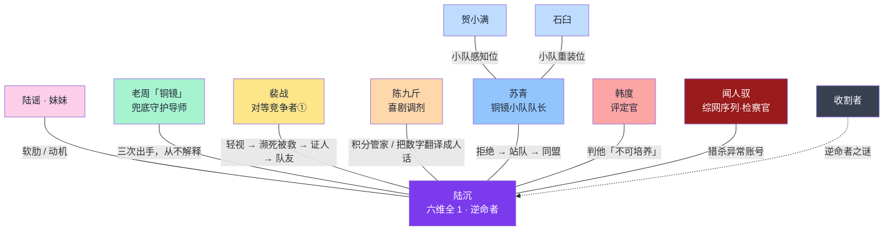

# 06 · 人物设定：全角色完整档案

> 本文件是**人物设定的唯一真相来源**。所有属性数值、说话方式、关系均以本文件为准。
> 方法依据：卫星式群像三型（对等竞争者／兜底守护导师／喜剧调剂）＋ Save the Cat 的 want/need/阻碍三件套。

---

## 〇、关系矩阵

---

## 〇·补　功能位总表

> **人设必须从故事反推**——每个角色的存在理由，是"补主角的一个缺陷"。权威版本见 `21_三大框架.md` 第五节。

| 角色 | 功能位 | 具体怎么补 |
|---|---|---|
| **陆沉** | 主角 | 缺陷：**他不肯让别人替他承担**。这是他的病，也是全书要治的东西 |
| **陆谣** | 补「他没有软处」 | 她会对他发火，会拒绝被保护——她不是被保护的对象，她是会反抗的人 |
| **苏青** | 补「他不肯开口求人」 | 她会直接替他做决定，然后让他承担后果 |
| **老周** | 补「他看不见全局」 | 他知道很多但不全说，逼主角自己问出来 |
| **陈九斤** | 补「他太冷」 | 把数字翻译成人话——**他是读者的情绪替身** |
| **裴战** | 补「他没有外部认可」 | 作为对照，证明「面板好」和「能活下来」是两回事 |
| **韩度** | 反派·制度层 | 他的判断**在规则层面是对的**——他不是坏人 |
| **闻人驭** | 反派·武力层 | 他不只是在执行，**他在害怕** |
| **收割者** | 终极 | 上一个文明的变量 |

> **一句定调**：**他们不是坏人，他们是这套规则里最尽职的人。**
> **主角要赢的不是他们，是规则。**

---

## 一、核心二人

### 1.1 陆沉

| 项目 | 内容 |
|---|---|
| **属性面板** | 力量 1｜敏捷 1｜体质 1｜智力 1｜魅力 1｜感知 1（**总和 6**，修正全 −5） |
| **职业** | 逆命者（隐藏分支）／等级 1 |
| **年龄** | 18 |
| **身份** | 第三区，清退序列待复核编号 417 |
| **Want（想要）** | 90 天内让妹妹的户籍活下来 |
| **Need（需要）** | 学会**允许别人替他承担**——承认自己一个人扛不住所有人 |
| **恐惧** | 不是死。是**"他算准了一切，却还是有人替他死了"** |
| **底线** | 失败代价优先落在自己身上；不拿别人换逆命值 |

**弧光**：被动挨打 → 主动计量失败 → 用失败换回一队人 → 发现自己成了被猎杀的对象 → 学会发牌

**说话方式**
- 短句、陈述句、不反问、不用感叹号；常以**数字**结尾；
- 从不解释自己，只回答问题；
- 唯一的例外：提到妹妹时会出现一个「吧」字（人设松动点）。

**台词样本**
> 「九十天之内，职业等级五级，属性总和三十以上。我记住了。」
> 「你的运气可以浪费，我的不能。」
> 「不用。我赌自己。」

**外貌**（成文）：一米七八，偏瘦，肩膀窄，手腕细。头发剪得很短，露出一截后颈。走路时左脚略微内八，习惯贴着墙根走。看东西时视线偏低——**他在算地面到那个东西的距离**。旧外套的拉链坏了，用一枚别针别着；指甲剪得极短，指尖有磨出来的茧，右手虎口一道浅疤。
**标志物**：**算数的时候，右手会在裤缝上轻轻敲**——节奏是数拍子。
**变化线**：等级越高，**手上的灰越洗不掉**（负能量位面留痕），第 16 章起常驻。
**物件**：父亲的编号牌、妹妹给的包子纸袋、一张写着五条规则的纸（第 04 章起）
**宿**：0 立方米（综网分配给他的私人空间配额为零——面板提示 `【该账号空间配额为 0。】`）
**负重**：力量 1 → **负重上限几乎为零**。他捡到的好东西**绝大多数带不出来**——全卷随身物只有三件，这不是穷，是物理上做不到
**资历**：**永远为 0**。资历由「已消耗的经验值」转化，而他没有任何可以消耗经验值的地方（学不了技能、属性抽选无意义）→ 系统据此永远判定他「不可培养」
**引导者栏**：别人的引导者会下派任务与提示，他那一栏是 `【—】`
**称号栏**：空。综网的称号仓库上限 10 格、只生效佩戴中的称号——他**一格都没有**
**药物**：体质 1 → 服用任何新的恢复药都会触发抗药性检定，而他**必然大失败** → 他连一瓶恢复药都用不了
**适应期**：第 19 章升 5 级后进入适应期，加成只生效一半——**看得见，用不了**

---

### 1.2 陆谣

| 项目 | 内容 |
|---|---|
| **属性面板** | 力量 4｜敏捷 6｜体质 5｜智力 7｜魅力 5｜感知 4（**总和 31**，丙等边缘） |
| **年龄** | 14 |
| **Want** | 让哥哥别再去副本 |
| **Need** | 学会**被讨厌也没关系**——她必须敢于对哥哥发火 |
| **恐惧** | 被当成累赘；被送走 |
| **底线** | 不说谎（这是她和哥哥唯一的差别） |
| **F2 伏笔** | 总和恰为 31——比清退线高 1 点。**这个数字是被人调过的** |

**弧光**：被保护者 → 察觉者 → 主动者（第 04 章起她开始自己查资料、自己去找韩度）

**说话方式**：短句、直接、会打断哥哥、用「你」开头质问。

**台词样本**
> 「哥，我不吃。你先说你今天摔了几次。」
> 「你算概率的时候，算过我吗。」
> 「他们说我是你的累赘。我听到了。我记住他们了。」

---

## 二、卫星三型（缺一不可）

### 2.1 老周「铜镜的周」——兜底守护导师

| 项目 | 内容 |
|---|---|
| **属性面板** | 力量 9｜敏捷 13｜体质 10｜智力 13｜魅力 12｜感知 **17**（**总和 74**，甲等下位） |
| **职业等级** | 不明（对外自称「早就掉队了」，实际 ≥ 3） |
| **Want** | 找到一个能接住这盘棋的人——他找了九年 |
| **Need** | 承认自己救不了所有人（他一直没做到） |
| **恐惧** | 铜镜上再照出一张他熟的脸 |
| **底线** | 不追问别人用命换来的东西；不替别人做决定 |

**功能纪律**：**全卷只出手三次，每次都不解释。**
| 次 | 章节 | 出手内容 |
|---|---|---|
| ① | 08 | 给情报：「你输一次，比他们赢一次还值钱」 |
| ② | 15 | 给退路：序列营的侧门位置 |
| ③ | 19 | 给物件：把铜镜塞给他，说「这次该你照了」 |

**台词样本**
> 「我不问你里面的事。规矩我懂——别人拿命换出来的东西，我开口问就是抢。」
> 「你以为你在赌自己。可你妹妹、可苏青、可那些跟你进副本的人——他们早就在赌了。你凭什么替他们决定不赌？」
> 「铜镜这东西，照的不是人。」

---

### 2.2 裴战——对等竞争者①

| 项目 | 内容 |
|---|---|
| **属性面板** | 力量 14｜敏捷 12｜体质 11｜智力 10｜魅力 7｜感知 8（**总和 62**，甲等） |
| **Want** | 证明自己不是靠运气 |
| **Need** | 承认有人比他强，且**不因此崩溃** |
| **恐惧** | 被看穿——他三分钟首通那一次，是先手掷出了 3/36 的运气 |
| **底线** | 不背后捅刀（前期嘴贱但不坏，这是他能被救的前提） |

**弧光**：轻视（01、03）→ 嘴硬（05）→ 濒死被救（11）→ 主动作证（13）→ 队友（18）→ **替陆沉挡下一次改判反噬（20）**

**台词样本**
> 「三分钟。我一个人清掉的。」
> 「我不是来道谢的。我是来告诉你，那天我确实算错了。」
> 「你他妈的赢了。你他妈的居然赢了。」

---

### 2.3 陈九斤——喜剧调剂（新增角色）

| 项目 | 内容 |
|---|---|
| **属性面板** | 力量 6｜敏捷 5｜体质 7｜智力 7｜魅力 5｜感知 3（**总和 33**，丙等） |
| **年龄** | 20 |
| **身份** | 西市场杂货铺伙计兼回收站分拣工；黑市积分二道贩子 |
| **Want** | 攒够 500 积分，把母亲的户籍从丙等升到乙等 |
| **Need** | 明白有些账不能拿命算 |
| **恐惧** | 疼（极其怕疼，全书唯一会因为擦伤哭出声的角色） |
| **底线** | 不欠人情（他账本记得比谁都清） |

**功能**：把数字翻译成人话——「哥，二十积分，咱这一周的饭钱」；在高压场景后提供呼吸口；负责情报中转与道具采买。

**台词样本**
> 「哥，二十积分。二十！咱这一周的饭钱啊！」
> 「别别别，那玩意儿碰不得，碰了要还债的。」
> 「我我我……我腿软，但是我来了。」

---

## 三、铜镜小队

### 3.1 苏青（队长）

| 项目 | 内容 |
|---|---|
| **属性面板** | 力量 12｜敏捷 16｜体质 13｜智力 14｜魅力 11｜感知 15（**总和 81**，甲等） |
| **职业等级** | 3 级（阶层一上限） |
| **Want** | 让「铜镜」这个名字活下来（小队九年换了四批人） |
| **Need** | 承认**算术不是全部**——她第一次算错，是因为她把「异常值」当成误差剔除了 |
| **恐惧** | 又一次在名单上签字 |
| **底线** | 绝不丢下队友；也绝不让一个必败因素进队 |

**弧光**：拒绝（05）→ 被迫同队（06）→ 承认算错（07）→ 被停职（13）→ 公开站队（14）→ 把队长的位置让出来（20）

**说话方式**：完整句、数据驱动、几乎不用语气词。

**台词样本**
> 「带上你，我们全队的失败率上升 17%。这不是歧视，这是算术。」
> 「我不需要你的感谢。我需要你下一次还活着。」
> 「陆沉，你算得对。这题我算错了。」

---

### 3.2 贺小满（感知位）

| 项目 | 内容 |
|---|---|
| **属性面板** | 力量 7｜敏捷 11｜体质 9｜智力 10｜魅力 8｜感知 9（**总和 54**，乙等） |
| **定位** | 小队的眼睛；话少，会画画（把看到的场景速写下来） |
| **Want** | 活着攒够钱搬出第三区 |
| **功能** | 提供侦查信息；她的速写本第 18 章会成为关键证物 |

### 3.3 石臼（重装位）

| 项目 | 内容 |
|---|---|
| **属性面板** | 力量 15｜敏捷 5｜体质 13｜智力 6｜魅力 5｜感知 7（**总和 51**，乙等） |
| **定位** | 二十五岁，沉默，扛伤害的；是苏青带的第一批人里唯一活下来的 |
| **Want** | 无（他只想按苏青说的做）——**这是他的悲剧点** |
| **功能** | 第 15 章为掩护全队重伤，成为 All Is Lost 的一部分 |

---

## 四、对抗层

### 4.1 韩度（制度层反派）

| 项目 | 内容 |
|---|---|
| **属性面板** | 力量 7｜敏捷 8｜体质 8｜智力 15｜魅力 14｜感知 9（**总和 61**，甲等下位） |
| **身份** | 第三区评定署评定官；三年前「大重排」名单的签字人之一 |
| **Want** | 让规则正常运行——他相信规则是唯一能挡住混乱的东西 |
| **Need** | 承认规则杀过人，且他签了字 |
| **恐惧** | 第三区再出一次「接入日」那种事 |
| **底线** | 不伪造数据（**除了那一次**） |

**写作纪律**：他的每一次判断，在规则层面都是**正确的**。他的错只在于——**他懂得用平均值丈量所有人**。

**F6 伏笔**：01 章宣读判词时手在抖 → 16 章揭晓——**三年前签下 000416（陆铮）清退令的人，就是他**。他见过这个面板，一模一样。

**台词样本**
> 「按规定，我不能给你任何建议。」
> 「我签的名单。零是我写的。」
> 「你父亲的名字，在第四页第七行。」

---

### 4.2 闻人驭（对抗层 BOSS）

| 项目 | 内容 |
|---|---|
| **属性面板** | 力量 16｜敏捷 14｜体质 13｜智力 15｜魅力 12｜感知 12（**总和 82**，甲等上位） |
| **身份** | 综网序列·异常行为调查科，检察官 |
| **Want** | 把「异常账号」的存在从名册上抹掉——他干了七年，处理过 41 个 |
| **Need** | 承认他不只是在执行，他在**害怕** |
| **恐惧** | 有一天，面板上出现他自己的名字 |
| **底线** | 走流程。**他从不在流程之外动手**——这正是可以利用的弱点 |

**台词样本**
> 「异常账号编号 000417，我代表综网序列，向你确认一件事。」
> 「不着急。流程很长，我们有的是时间。」
> 「你不是第一个。你只是第一个还活着的。」

---

### 4.3 收割者（终极 BOSS·名字待定）

| 项目 | 内容 |
|---|---|
| 出场 | 第二卷起，第一卷只以「名字」和「物件」存在（净场地面刻痕、铜镜材质） |
| 本质 | 上一个纪元里，把文明「收割」掉的那一方；综网是它留下的筛子 |
| 与主角的关系 | 「逆命者」是筛子上的一条缝——**而缝是它自己划的** |

---

## 五、已故／背景人物

| 角色 | 面板 | 信息 |
|---|---|---|
| **陆铮**（父） | **官方档案**：力量 11｜敏捷 9｜体质 10｜智力 9｜魅力 9｜感知 8（总和 56，乙等下位，后降为丙等外包工） **真相**：**六维全 1**——九年来第 **8** 个「不适用常规评估」的账号 | 三年前死于探索型副本塌方；原评定编号 **000416**（在陆沉前面一号）；**档案在他死后被改成了"总和 56"**，用来掩盖异常账号；签他清退令的人是韩度；遗物：编号牌 |
| **母亲**（未具名） | 力量 6｜敏捷 8｜体质 4｜智力 11｜魅力 10｜感知 9（**总和 48**） | 陆沉 12 岁时器官衰竭去世；治疗需 3000 积分，她只凑到 700 分 |

> **416 与 417**：父亲是上一号的「不可评估账号」。01 章韩度手抖的真正原因。

---

## 六、配角出场节奏表

> 纪律：同一章最多引入 **2** 个新角色，避免配角爆炸。
> **例外**：第 05 章是"小队成型 + 报名"三线并进的一章，允许一次引入 4–5 人。

| 章 | 首次出场 | 本章承担功能 |
|---|---|---|
| 01 | 陆沉、陆谣、韩度、裴战 | 主角／动机／制度／轻视方 |
| 03 | 老周（远景，只给一句问话） | 悬念 |
| 05 | 苏青、石臼、贺小满、陈九斤、**贾算** | 专业层／喜剧调剂／小队成型／**中段可恨的具体人** |
| 08 | 老周（正式交涉） | 情报源 |
| 12 | 回声市场掌柜 | 解密 NPC（非队友，一次性但有后效） |
| 13 | **闻人驭** | 对抗层 BOSS |
| 18 | 十名甲等玩家（群像，不逐一命名） | 围猎方 |

### 6.1 贾算（中段反派 · 第 05–10 章）

| 项目 | 内容 |
|---|---|
| 姓名 | 贾算（外号「贾半成」） |
| 面板 | 41 岁｜总和 39（丙等偏下） |
| 身份 | 西市场的**副本报名掮客**；经手全区的组队、报名、结算抽成 |
| 手段 | ① 吃两头回扣；② 伪造队伍资质；③ **把没人要的人塞进死亡率最高的队**——因为死人不退报名费 |
| 与主角的冲突 | 多收陆沉 **10 积分**（本该 10，收他 20）。理由：「你这种面板，本来就该多交点押金。」 |
| 动机 | 不是恶——**他自己当年也是被塞进高危队的人** |
| **打脸点** | 第 07 章之后，陆沉用记在纸上的五条规则当众拆他的账：**报名 4 人收 80 积分，报给管理局的是 40，差额去哪了** |
| 退场 | 被清查。临走一句：**「你现在能算我了。等你算不动的时候，你就成了我。」** |
| 功能位 | ① 给中段一个可恨的具体人；② **展示"积分经济"的社会面孔**；③ 让主角的"算"第一次变成武器而非自保 |

---

## 七、人物一致性检查清单（每章写完自查）

- [ ] 陆沉本章的话，是否有一句是**解释自己**的？有则删除或改写为陈述。
- [ ] 陆沉本章有没有用感叹号？有则复核。
- [ ] 反派本章的决策，在**规则层面**是否站得住脚？站不住则重写。
- [ ] 出场配角是否都有明确的**当下目的**（不是"来推动剧情"）？
- [ ] 九斤是否在本章承担了呼吸口？（每 3 章至少 1 次）
- [ ] 妹妹是否又有"被保护者"的纯功能化表现？连续 2 章出现则须给她一个主动选择。
