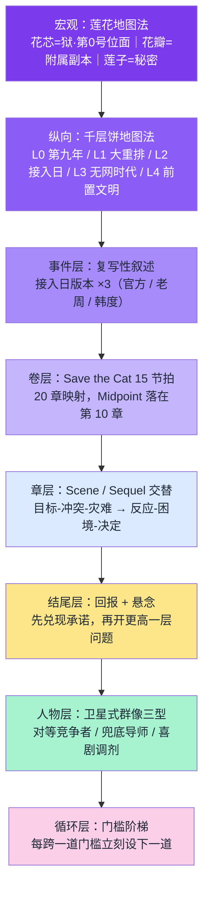

# 04 · 写作方法论调研与应用

> 调研目的：把「只有一份大纲」的状态，变成「每一章都能照着写」的状态。
> 所有方法论均标注来源与提出者，并逐条给出**在本书中的落地方式**。

---

## 一、莲花地图法（宅猪，阅文白金作家，《牧神记》）

### 原始论述（要点摘录）

> 「别人上来新手村，我上来就是 BOSS 村。」
> 「我们先来画一朵莲花，先画莲花的花芯，然后画花瓣，每一个花瓣就是一个附属地图，花瓣有很多，足够你写出很长的情节。而花芯里的莲子，就是你要揭开的秘密。」
> 「一开始的地图是什么地图呢？我的选择是终极地图，大墟。一开始就写终极地图是怎么写的呢？终极地图写完了还能写什么？我的解决办法是——**不写完**。」
> 「秦牧从终极地图大墟里走出来，去了第一个地方，附属地图延康国。延康国写完了，写什么？**回终极地图大墟，揭开一些秘密，再出去。**」

### 解决的核心问题

传统「飞升流」换地图时会**掉订阅**：凡间 → 仙界，人际关系全断，读者产生割裂感。
莲花地图法让主角的**朋友圈始终留在花芯**，每次换花瓣只是「出去一趟，再回来」。

### 三条硬约束

1. **花芯必须是终极地图**，且**永不写完**——埋秘密、留伏笔，只揭开一部分；
2. **每个花瓣是独立地图，但都绕着花芯转**——花瓣之间的黏连性来自「共同服务于同一个中心」；
3. **莲子是秘密**——花瓣的收益不是资源，而是**关于花芯的一条信息**。

### 本书的落地（详见 `05_地图设定`）

| 莲花结构 | 本书对应 |
|---|---|
| **花芯（终极地图）** | **「狱」——综网第 0 号位面**（以「练习副本·净场」的面貌出现在主角面前） |
| **莲子（秘密）** | 8 条，全部关于「综网是什么／逆命者是什么」（F1、F4、F7 在此回收） |
| **花瓣（附属地图）** | 西市地宫 → 索道 → 回声市场 → 九号站台 → 围猎场 → 评定署 |
| **回来的动作** | 每次副本结束，主角必回第三区（现实层），用新增的逆命值/积分兑换下一步 |

> **与原文设定的咬合点**：《通宵杀敌》原文第 4713 行写着「**新手教程的世界不是凭空出现的**」——这句话正是莲花地图法的天然接口：那片「净场」的灰，不是虚拟训练场，而是**第 0 号位面「狱」的一块切片**。主角第一次进的不是练习副本，是**终极地图的门口**。

---

## 二、千层饼地图法（宅猪，同一篇论述）

### 原始论述（要点摘录）

> 「不是叠饼子，也不是叠地图。叠什么？**叠历史**。」
> 「牧神记中，我叠了四个历史时代：龙汉、赤明、上皇、开皇。秦牧所出的时代是延康时代，上面四个时代就是历史中的千层饼。」
> 「写延康的同时，主角一点一点地挖掘上面四个时代的历史。挖掘的时候，书的深度和广度也就出来，有了厚重感。」
> 「你觉得这个地图已经写完了，然而历史挖出来，还可以继续写。**这就相当于，在莲花地图下，再铺一层莲花。**」
> 「最后一点：**人物也就有了过去，人物形象容易立体起来。**」

### 本书的落地（详见 `05_地图设定` 第三节）

综网只降临了九年，因此历史层不必很长，但**必须够深**：

| 层 | 时间 | 名称 | 这一层埋着什么 |
|---|---|---|---|
| L0 | 现在 | **第九年** | 主角所在的「面板即身份」社会 |
| L1 | 三年前 | **大重排** | 人口按属性重排，119 万人被划入清退序列（陆沉的父亲死在这一年） |
| L2 | 第一天 | **接入日** | 全世界同一秒看见面板；「隐性确认」条款生效 |
| L3 | 接入之前 | **无网时代** | 综网为什么会来？——**它来过一次** |
| L4 | 上一个纪元 | **前置文明** | 地球不是第一个被接入的文明；「收割者」在此 |

> **写作纪律**：每挖出一层历史，必须同时**给一个活人一个过去**。历史层不是设定展示，是人物立体化的工具。例如 L1「大重排」一挖开，韩度手上那道抖就有了来源。

---

## 三、复写性叙述（中国作家网评《牧神记》，与千层饼配套）

### 定义

> 「『千层饼』式历史揭秘手法还表现为**复数性叙述**，即同一件事反复出现却又稍有变化，进而将故事补充完整。作者跳出主角视角，用不同人的记忆经历去建构和还原一桩事件的原本面目。」

### 本书的落地

**选定「三次复写」的核心事件：接入日第一天，第三区到底发生了什么。**

| 复写次序 | 讲述者 | 版本 | 出场章 |
|---|---|---|---|
| 第一次 | 官方通稿 | 「全区平稳过渡，无人员伤亡」 | 05（副本结算大厅的公告屏） |
| 第二次 | 老周 | 「那天第三区死了四千人，名册上写的是零」 | 08 |
| 第三次 | 韩度 | 「我签的名单。零是我写的。」 | 16 |

> 第三次复写时，主角才意识到：**韩度不是制度的脸，韩度是制度的伤口。**
> 这一手法同时完成了反派立体化 + 历史层下沉 + F6 伏笔回收。

---

## 四、换地图的深层设计（业界通行规则，见多家写作方法论）

### 四条规则

1. **新地图 ＝ 新环境 + 新角色 + 新规则 + 新目标 + 新冲突**（缺一项就是注水）；
2. **换图前**：旧地图的核心冲突至少阶段性解决；
3. **换图后**：前 5 章必须快速建立新的代入感与期待感；
4. **绝对禁止**：旧角色一刀切抛弃、新设定一次性全部倒出、新地图与旧地图毫无关联。

补充规则（来自长篇连载写作体系）：**每换一次地图，循环必须升级——更大的规模、更高的门槛、更强的对手。**

### 本书的落地

本书是**无限流**，天然高频换图，因此这条规则是生死线。执行标准：

| 换图 | 旧冲突是否阶段解决 | 带走的人际关系（≥1 条贯穿） | 循环升级 |
|---|---|---|---|
| → 西市地宫 | ✅（决定不再只挨打） | 老周、苏青 | 门槛：从「单人练习」到「多人协作」 |
| → 索道 | ✅（首次翻命成功） | 铜镜小队全员 | 门槛：从「打怪」到「被追猎」 |
| → 九号站台 | ✅（小队解散后重组） | 苏青、裴战、九斤 | 门槛：阶层一 → 阶层二 |

> **贯穿主线（不可断）**：① 陆谣的 90 天倒计时；② 「该账号不适用常规评估」这行字。

---

## 五、Save the Cat 15 节拍（Blake Snyder 创，Jessica Brody 改编为小说版）

### 节拍表与位置

| # | 节拍 | 位置 | 作用 |
|---|---|---|---|
| 1 | Opening Image 开场画面 | 0-1% | 主角「旧世界」的快照 |
| 2 | Theme Stated 主题呈现 | 5% | 由**他人**说出主角最终要学会的东西 |
| 3 | Setup 铺垫 | 1-10% | 日常世界、配角、主角以为能解决问题的目标 |
| 4 | Catalyst 催化事件 | 10% | 打破平衡，回不去了 |
| 5 | Debate 犹豫 | 10-20% | 主角抗拒改变 |
| 6 | Break Into Two 进入第二幕 | 20% | **决定 + 行动**，正式踏上旅程 |
| 7 | B Story B 故事线 | 22% | 引入帮主角学会主题的人 |
| 8 | Fun and Games 趣味与游戏 | 20-50% | 核心卖点展开（读者来的理由） |
| 9 | **Midpoint 中点** | **50%** | 重大转折：**虚假胜利**或虚假失败 |
| 10 | Bad Guys Close In 坏人逼近 | 50-75% | 对手加压，内部分裂 |
| 11 | All Is Lost 一无所有 | 75% | 失去一切 |
| 12 | Dark Night of the Soul 灵魂黑夜 | 75-80% | 谷底反思 |
| 13 | Break Into Three 进入第三幕 | 80% | 找到解法 |
| 14 | Finale 高潮 | 80-99% | 最终对决 |
| 15 | Final Image 终场画面 | 100% | 「新世界」快照 |

**关键前置**：填节拍之前，必须先定死主角的 **want（想要）/ need（需要）/ 阻碍**。

### 本书的落地

**陆沉的三件套**：
- **Want**：在 90 天内让妹妹的户籍活下来（具体、可倒计时、可失败）；
- **Need**：学会**允许别人替他承担**——他必须承认「一个人扛不住所有人」，也必须接受有人愿意为他挡一次；
- **阻碍**：他的成长依赖于「失败」，而失败会伤人；越强，越需要有人为他受伤。

> 这条 need 是全书主题句的来源。
> **Theme Stated 定在第 04 章**，由陆谣说出：「哥，你能不能别老是一个人。」
> **第 08 章老周说出它的另一半**：
> 「你以为你在赌自己。可你妹妹、可苏青、可那些跟你进副本的人——他们早就在赌了。你凭什么替他们决定不赌？」

完整 20 章映射见 `08_首卷节拍表`。

---

## 六、场景-续景 Scene / Sequel（Dwight Swain 体系，业界通用）

### 两种单元交替

| 单元 | 结构 | 作用 |
|---|---|---|
| **Scene 场景** | **目标 → 冲突 → 灾难** | 推动情节，结尾必须是**灾难**（比开头更糟） |
| **Sequel 续景** | **反应 → 困境 → 决定** | 让读者喘息，结尾必须给出**新决定** |

交替使用，节奏自然产生：紧张 → 缓冲 → 更紧张 → 缓冲。

### 本书的落地（与 Save the Cat 叠加使用）

- 每章 = 1~2 个 Scene + 1 个 Sequel；
- **Sequel 是本书塑造「冷静算计」人设的主战场**——陆沉的反应（Reaction）永远是算账，困境（Dilemma）永远是选择题，决定（Decision）永远是一条硬规则；
- 例（第 03 章）：Scene 目标=验证机制 → 冲突=只有大失败才算 → 灾难=他必须主动挨打；Sequel 反应=「这个结算是稳定的」→ 困境=攒 10 点要不要拿队友换 → **决定=不换，写在纸上当规矩**。

> **纪律**：Sequel 的「决定」必须是一条**可被后文检验的规则**。这样主角才是「有原则的人」，而不是「随剧情走的工具」。

---

## 七、卫星式群像体系（长篇连载方法论）

### 三类配角，缺一不可

| 类型 | 功能 | 本书角色 |
|---|---|---|
| **对等竞争者** | 天赋不弱于主角，甚至阶段性碾压，长期制造追赶博弈 | **裴战**（62 分天才）→ 后期升级为**闻人驭**（82 分检察官） |
| **兜底守护导师** | 只在重大生死危机时出手，不包办战斗，提供稳定安全感 | **老周（铜镜）** |
| **节奏调剂喜剧角色** | 高压剧情后缓和氛围 | **陈九斤**（新增，西市场杂货铺伙计） |

### 两条纪律

1. **配角不能用完即弃**：每个人物都要有完整成长脉络；主线平缓时切视角写配角专属故事（不是灌水，是世界观扩容）；
2. **配角要有独立人生轨迹**：他们围绕主角运转，但不是为主角服务。

### 本书的落地

- 裴战：**轻视 → 濒死被救 → 成为证人 → 成为队友 → 第 20 章替陆沉挡下一次改判的反噬**；
- 老周：全书只出手 **3 次**（第 08 章给情报、第 15 章给退路、第 19 章给一面铜镜），每次都不解释；
- 陈九斤：负责「把数字翻译成人话」——他是全书唯一会为积分哭的角色。

---

## 八、门槛设计（连载循环方法论）

### 规则

> ① 门槛必须围绕**核心卖点**设计，脱离金手指和脑洞的门槛是无效剧情；
> ② 门槛要**分批提出**，不要一次全甩给读者；
> ③ **每跨越一个门槛，就立刻设立下一个。**

### 本书的落地（门槛阶梯）

| 阶段 | 门槛 | 围绕的核心卖点 |
|---|---|---|
| 第 01-03 章 | 活过 90 天 / 攒够 10 点 | 「失败是资源」的验证 |
| 第 05-07 章 | 用一次翻命救下整队 | 翻命必须付代价 |
| 第 10-11 章 | 在「被记录」的状态下继续赢 | 系统会纠偏 |
| 第 14-18 章 | 越过阶层一，进入阶层二 | 门槛提升 = 失败量级提升 |
| 第 20 章 | 改写**他人**的骰子 | 从被发牌到发牌 |

---

## 九、章节结尾公式（回报 + 悬念）

### 规则

> 只有悬念没有回报，读者会疲惫；只有回报没有新问题，读者会失去追更动力。
> **有效结尾 ＝ 先兑现本章的一部分承诺，再打开更高一层的问题。**

五种结尾型：
1. **信息型**：真相揭开一角，但新证据推翻原有判断；
2. **行动型**：完成当前计划，却触发更危险的后果；
3. **关系型**：确认联盟，但必须为此承担代价；
4. **身份型**：获得新身份/能力/资源，同时进入新规则；
5. **价值型**：赢得事件，却发现胜利违背底线。

### 本书的落地

逐章指定结尾型（见 `08_首卷节拍表` 的「章末钩子类型」列），并保证：
- 前 3 章用**信息型**（异常小字 / 逆命者协议 / 老周的问句）；
- 中段多用**行动型**（赢了但被记录）；
- 第 20 章用**身份型**（他成为了发牌的人）。

---

## 十、方法论叠加图（本书使用的完整结构）

---

## 十一、调研结论：本次完善解决了哪些「黑箱」

| 黑箱问题 | 解决文档 |
|---|---|
| 地图长什么样、还有哪些地方可写 | `05_地图设定`（花芯 + **7 花瓣** + 5 历史层） |
| 每个配角是谁、他要什么、怎么说话 | `06_人物设定`（含属性面板与台词样本） |
| 每个副本具体怎么写（规则/怪物/失败条件） | `07_副本设计卡`（8 张标准卡） |
| 每一章要完成什么、钩子是什么 | `08_首卷节拍表`（15 节拍 × 20 章 × 场景拆解） |
| 名词、道具、怪物叫什么、什么数值 | `09_术语与图鉴` |

---

*调研来源：宅猪《宅猪说地图·章二/章三》（搜狐、ima 文库转载）；中国作家网《放牧诸神的变法宏图》；《宅猪：十年前辞职写网文》（中国作家网）；笔灵 AI 写作《如何换地图》；Jessica Brody《Save the Cat! Writes a Novel》；Blake Snyder《Save the Cat!》；Randy Ingermanson 雪花写作法；Dwight Swain 场景-续景体系；长篇连载工业化创作方法论（今日头条）；《媒介可供性与网络小说的叙事生成》（孙葳）。*
