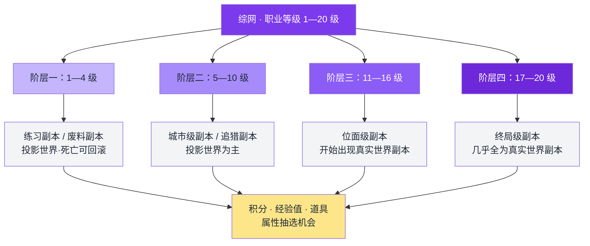
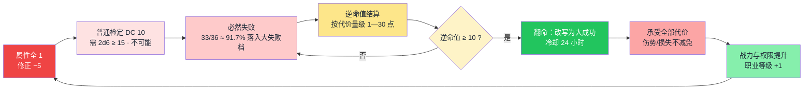
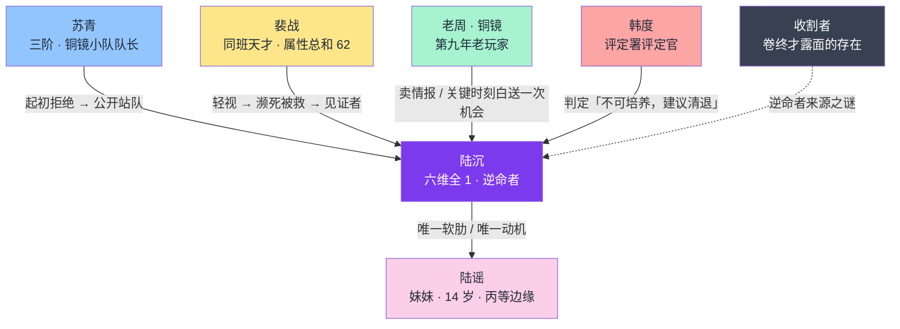
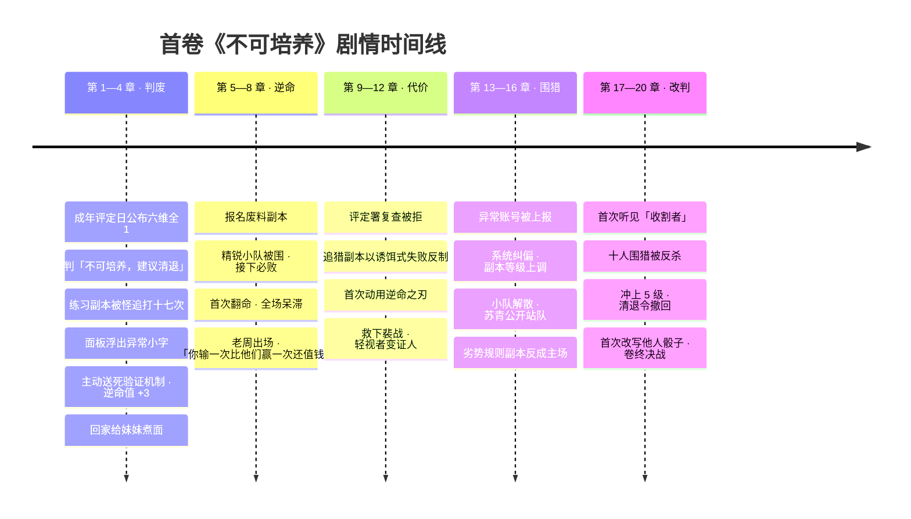
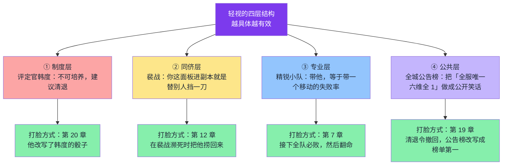

# 关键情节图解：综网 · 废柴逆命

> ⚠️ **版本说明**：本文件的人物关系图与打脸层级图为**首版**。**势力分布（拾荒者 → 三层反派）见 `21_三大框架.md` 第二节与 `05_地图设定` 六·补**，两者冲突时以后者为准。
>
> 所有图使用标准 Mermaid 语法，可独立渲染。

---

## 一、等级与阶层体系图

---

## 二、逆命者机制闭环图

> 关键：**失败 → 资源 → 翻盘**，而代价全程不可免除。这是全书「爽点有成本」的结构保证。

---

## 三、人物关系图

---

## 四、首卷剧情时间线

---

## 五、打脸对象层级图

---

*图解与《02_全局大纲》逐条对齐。*
